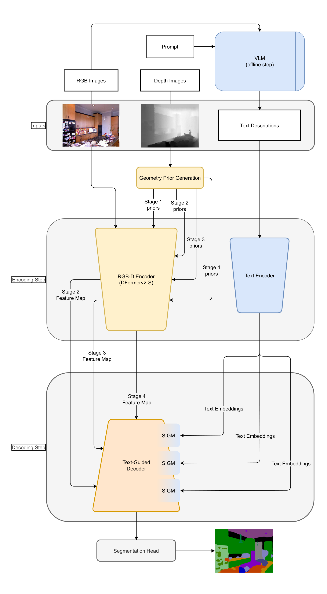
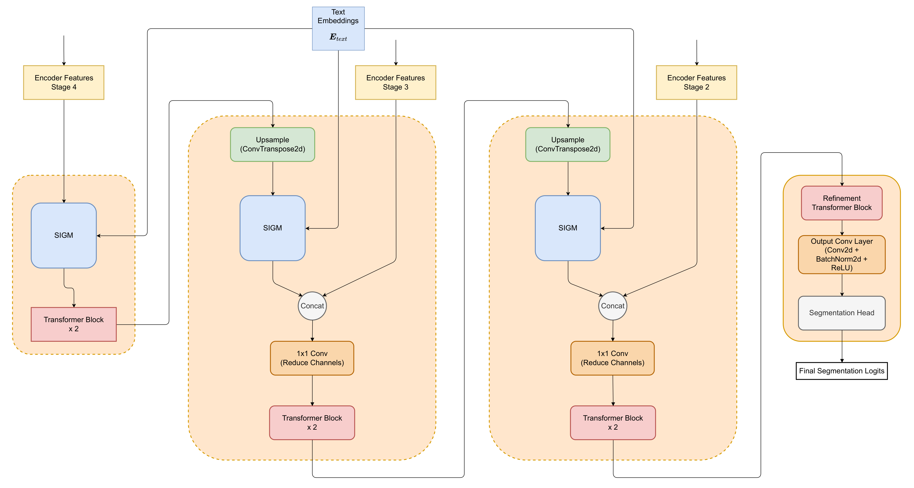
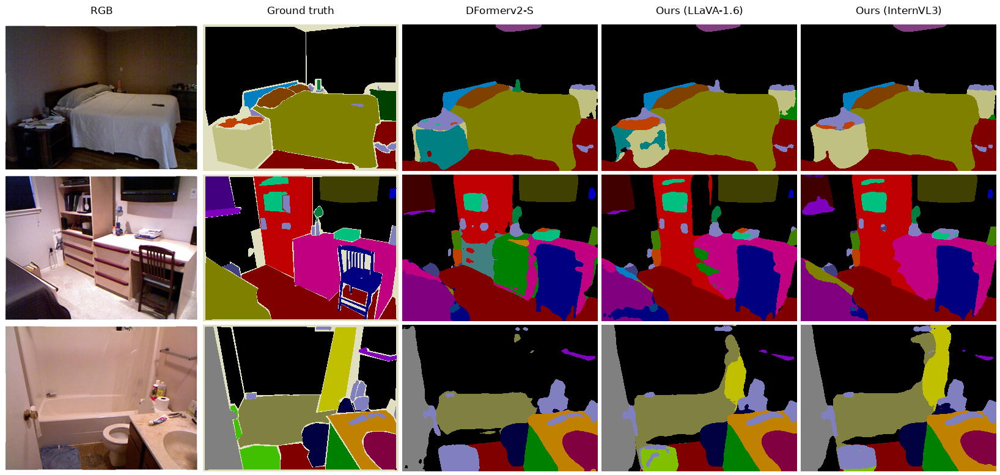

# Enhancing Semantic Segmentation via Multimodal Fusion

Text-guided RGB-D semantic segmentation: the code of my master's thesis at the Technical University of Munich (2025).

The model extends the RGB-D segmentation network [DFormerv2](https://github.com/VCIP-RGBD/DFormer) with natural language as a third modality. A vision-language model describes every scene once, offline. A frozen text encoder turns the description into an embedding, and a hierarchical decoder uses it to modulate the RGB-D features at each decoding stage, following [Text-IF](https://github.com/XunpengYi/Text-IF).

<p align="center">
  
</p>

## Method

- **RGB-D encoder:** DFormerv2-S, pretrained on ImageNet. Depth enters as a geometry prior in the encoder's self-attention; the stage 2–4 features go to the decoder.
- **Captions:** generated with [LLaVA-1.6](https://huggingface.co/llava-hf/llava-v1.6-mistral-7b-hf) (Mistral-7B) or [InternVL3-38B](https://huggingface.co/OpenGVLab/InternVL3-38B), with the prompt *"Write a strictly factual description of the image, focusing on object positions and spatial relations."* The generated captions are part of this repository ([`captions/`](captions)).
- **Text encoder:** frozen [JinaCLIP v2](https://huggingface.co/jinaai/jina-clip-v2), which reads the full captions (up to 8192 tokens), or CLIP ViT-B/32 (77 tokens) for comparison.
- **Text-guided decoder:** at each level, a Semantic Interaction Guidance Module (SIGM) maps the text embedding to per-channel scale and shift parameters and modulates the visual features as $(1+\gamma) \odot x + \beta$. Transformer blocks then refine the features before they are upsampled and fused with the next encoder stage. The self-attention in these blocks is configurable: standard multi-head self-attention (default), MDTA from Restormer, Linformer, Performer or Efficient Attention.

<p align="center">
  
</p>

## Results

mIoU (%) on the test sets, with multi-scale (0.5–1.5) + flip sliding-window inference. The baseline is the official DFormerv2-S checkpoint, evaluated with the same protocol.

**NYUDepthv2**

| Model | Text encoder | Captions | mIoU | Config |
|---|---|---|:---:|---|
| DFormerv2-S (baseline) | – | – | 56.21 | `NYUDepthv2.DFormerv2_S` |
| Hierarchical decoder, no text | – | – | 56.00 | `NYUDepthv2.DFormerv2_S_no_text` |
| Ours | CLIP | LLaVA-1.6 | 56.52 | `NYUDepthv2.DFormerv2_S_text_clip` |
| Ours | JinaCLIP v2 | LLaVA-1.6 | 57.79 | `NYUDepthv2.DFormerv2_S_text` |
| Ours | JinaCLIP v2 | InternVL3 | **57.95** | `NYUDepthv2.DFormerv2_S_text_internvl3` |

**SUN RGB-D**

| Model | Text encoder | Captions | mIoU | Config |
|---|---|---|:---:|---|
| DFormerv2-S (baseline) | – | – | 52.14 | `SUNRGBD.DFormerv2_S` |
| Hierarchical decoder, no text | – | – | 52.18 | `SUNRGBD.DFormerv2_S_no_text` |
| Ours | JinaCLIP v2 | LLaVA-1.6 | **53.11** | `SUNRGBD.DFormerv2_S_text` |

**Attention in the decoder** (NYUDepthv2, JinaCLIP v2, LLaVA-1.6 captions)

| Multi-head self-attention | MDTA | Performer | Linformer | Efficient Attention |
|:---:|:---:|:---:|:---:|:---:|
| **57.79** | 57.29 | 57.14 | 56.95 | 56.24 |

The configs are `NYUDepthv2.DFormerv2_S_text` and `NYUDepthv2.DFormerv2_S_text_{mdta,performer,linformer,efficient}`.

<p align="center">
  
</p>

## Repository structure

```
captions/            VLM captions for NYUDepthv2 and SUN RGB-D
local_configs/       experiment configs (one per thesis result)
models/
  builder.py         encoder + (text-guided) decoder
  decoders/          hierarchical_text_decoder.py, attention.py, ham_head.py (baseline)
  encoders/          DFormerv2
  text_encoders/     CLIP and JinaCLIP v2 wrappers
tools/               caption generation, ground-truth visualisation
utils/               training, evaluation and data loading (from DFormer)
```

## Installation

```bash
conda create -n dformerv2-text -c conda-forge python=3.10 -y
conda activate dformerv2-text
pip install torch==2.3.1 torchvision==0.18.1 --index-url https://download.pytorch.org/whl/cu118
pip install -r requirements.txt
```

The text encoders are downloaded from the Hugging Face Hub on first use. JinaCLIP v2 is pinned to the revision used in the thesis.

## Data and weights

1. Download NYUDepthv2 and SUN RGB-D in DFormer's format from the [DFormer repository](https://github.com/VCIP-RGBD/DFormer#-get-started) and place them under `datasets/`:
   ```
   datasets/
     NYUDepthv2/  RGB/  Depth/  Label/   train.txt  test.txt
     SUNRGBD/     RGB/  Depth/  labels/  train.txt  test.txt
   ```
2. Download the ImageNet-pretrained backbone `DFormerv2_Small_pretrained.pth` from [Hugging Face](https://huggingface.co/bbynku/DFormerv2/tree/main/DFormerv2/pretrained) into `checkpoints/pretrained/`.
3. The captions are already in `captions/`. To generate them again, run for example:
   ```bash
   python tools/caption_llava_next.py --dataset_dir datasets/NYUDepthv2 --output_file captions/NYUDepthv2/llava-next.json
   python tools/caption_internvl3.py --dataset_dir datasets/NYUDepthv2 --output_file captions/NYUDepthv2/internvl3.json
   ```

## Training and evaluation

```bash
# Train (NYUDepthv2 on one GPU, SUN RGB-D on four GPUs, as in the thesis)
bash train.sh local_configs.NYUDepthv2.DFormerv2_S_text 1
bash train.sh local_configs.SUNRGBD.DFormerv2_S_text 4

# Evaluate a checkpoint (multi-scale + flip, sliding window)
bash eval.sh local_configs.NYUDepthv2.DFormerv2_S_text <checkpoint.pth>

# Save colourised predictions to output/
bash infer.sh local_configs.NYUDepthv2.DFormerv2_S_text <checkpoint.pth>
```

Training with a batch size of 16 needs about 50 GB of GPU memory. To check the setup, evaluate the official DFormerv2-S checkpoint ([Hugging Face](https://huggingface.co/bbynku/DFormerv2/tree/main/DFormerv2/NYU)); it should give 56.21 mIoU:

```bash
bash eval.sh local_configs.NYUDepthv2.DFormerv2_S checkpoints/trained/DFormerv2_Small_NYU.pth
```

## Acknowledgements

This repository is a fork of [DFormer / DFormerv2](https://github.com/VCIP-RGBD/DFormer), whose encoder, training and evaluation code it reuses. The decoder design and the SIGM follow [Text-IF](https://github.com/XunpengYi/Text-IF), MDTA and the feed-forward network come from [Restormer](https://github.com/swz30/Restormer), and the Linformer attention is adapted from [lucidrains/linformer](https://github.com/lucidrains/linformer).

## Citation

```bibtex
@mastersthesis{kahraman2025multimodal,
  author = {Eser Murat Kahraman},
  title  = {Enhancing Semantic Segmentation via Multimodal Fusion},
  school = {Technical University of Munich},
  year   = {2025}
}
```

Please also cite DFormerv2:

```bibtex
@inproceedings{yin2025dformerv2,
  title     = {DFormerv2: Geometry Self-Attention for RGBD Semantic Segmentation},
  author    = {Yin, Bo-Wen and Cao, Jiao-Long and Cheng, Ming-Ming and Hou, Qibin},
  booktitle = {Proceedings of the Computer Vision and Pattern Recognition Conference},
  pages     = {19345--19355},
  year      = {2025}
}
```

## License

MIT, like the original DFormer code. See [LICENSE](LICENSE).
